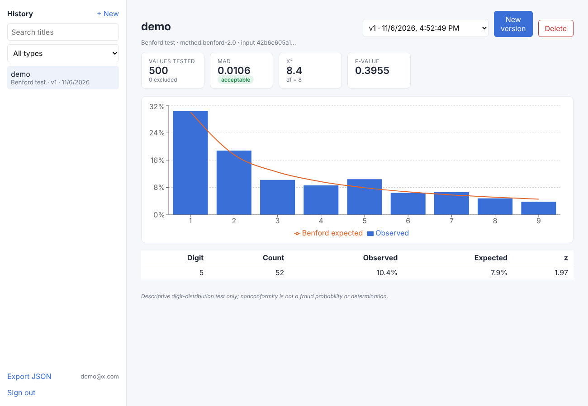
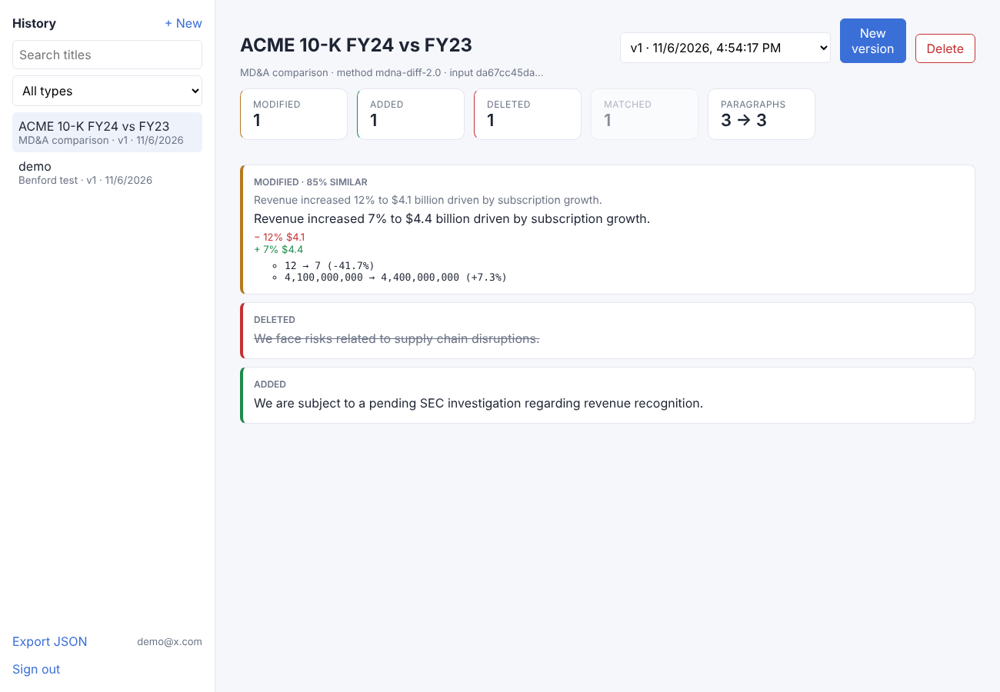

# FinGuard AI

Forensic screening for financial disclosures, built for the Wharton Forensic Analytics Lab project.
Paste a ledger column or two years of MD&A text; FinGuard runs statistical tests, explains what it
found, and keeps an auditable, versioned history of every run per user.




## What it does

| Analysis | Method |
| --- | --- |
| **Benford's Law** (first digit / first two digits) | MAD with Nigrini's conformity bands, Pearson χ² with an exact p-value (incomplete-gamma implementation, no SciPy), per-digit z-statistics with continuity correction |
| **Numerical anomaly screen** | Robust modified z-score outliers (median / MAD), repeated amounts, round-number bias, χ² test of last-digit uniformity |
| **MD&A comparison** | Multiset exact matching (correct with duplicate paragraphs) → greedy fuzzy pairing on token similarity → Added / Deleted / Modified / Matched, with word-level diffs and changed figures (e.g. `12% → 7%`, `$4.1B → $4.4B`) |

Financial text parsing understands `1,234.56`, accounting negatives `(2,000)`, `$4.1 billion`, `3.2M`,
and skips percentages and bare years where they would bias a digit test.

## Architecture

```
frontend/  React 19 + TypeScript + Vite + Recharts
   │  REST/JSON, Bearer JWT
backend/   FastAPI
   ├── routers/      auth, analyses (CRUD, versions, export, pagination/search)
   ├── schemas.py    Pydantic contracts; discriminated union per analysis kind
   ├── services.py   runs analyses, fingerprints input, appends versions
   ├── models.py     SQLAlchemy 2.0: users → analyses → analysis_versions
   └── analytics/    pure-Python core (benford, anomalies, mdna_diff, parsing, stats)
```

**Versioned records.** Every run is an immutable `analysis_versions` row holding the method version,
SHA-256 of the canonical input, parameters and full result. Re-running with identical input and the
same method version is idempotent (returns the existing version); new data appends `v2`, `v3`, ….

**Security.** bcrypt password hashing, short-lived HS256 JWTs, every query scoped to the
authenticated owner (other users' ids return 404, not 403), constant-time-ish login for unknown
emails, input size limits enforced at the schema layer.

## Run locally

```bash
# backend
cd backend
python -m venv .venv && source .venv/bin/activate
pip install -r requirements-dev.txt
uvicorn app.main:create_app --factory --reload        # http://localhost:8000/docs

# frontend (new terminal)
cd frontend
npm install
npm run dev                                           # http://localhost:5173 (proxies /api)
```

Configuration (environment variables): `FINGUARD_DATABASE_URL` (default SQLite; any SQLAlchemy URL
such as PostgreSQL works), `FINGUARD_JWT_SECRET` (required when `FINGUARD_ENV=production`),
`FINGUARD_JWT_TTL_MINUTES`, `FINGUARD_CORS_ORIGINS`.

## Tests

```bash
cd backend && pytest -q
```

19 tests: χ² p-values against reference tables, float-safe leading-digit extraction, conforming vs.
uniform data, outlier/duplicate/round-number detection, MD&A duplicate-paragraph semantics and
changed-figure extraction, plus API tests for auth, validation errors, per-user isolation, pagination,
export, and idempotent versioning. CI runs backend tests and the frontend type-check/build.

## Limitations

Results are descriptive screens, not fraud determinations. Benford analysis is only meaningful for
data spanning several orders of magnitude and not bounded by assigned ranges. The MD&A matcher works
at paragraph granularity, so a paragraph split into two shows as one Modified plus one Added.
